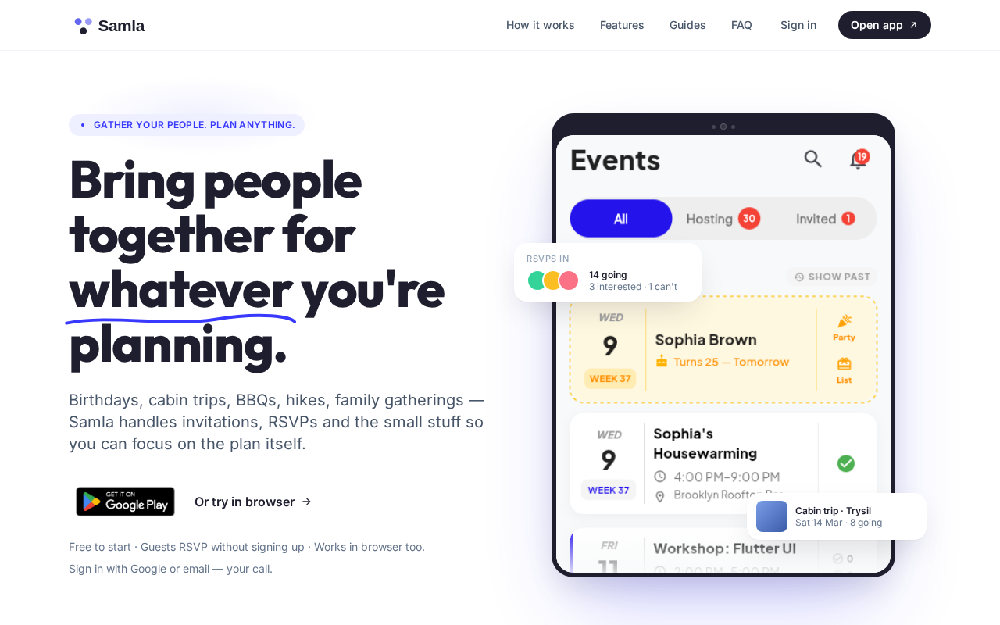
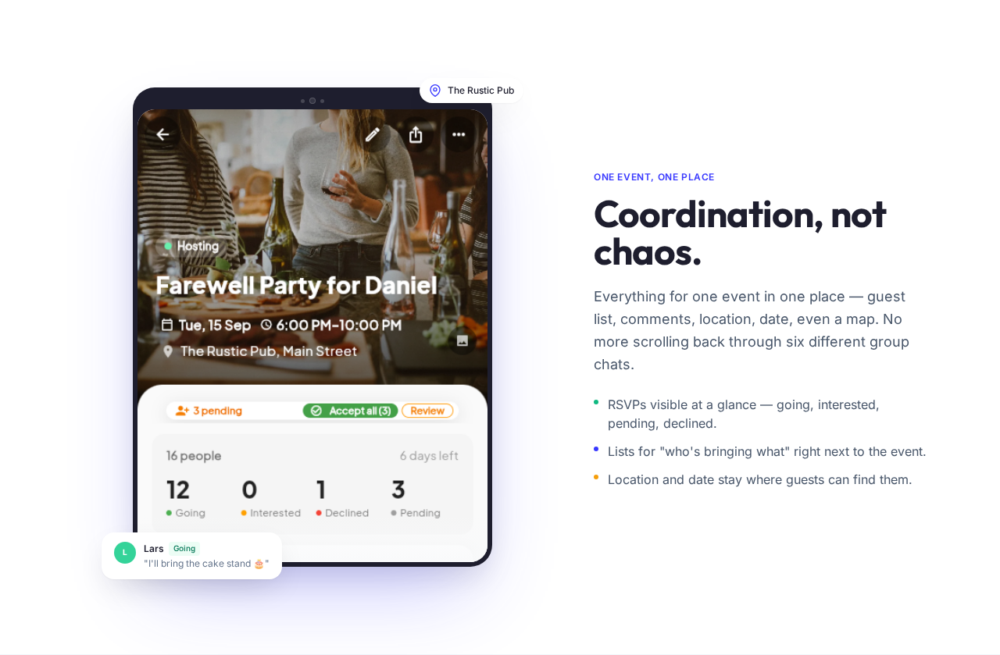
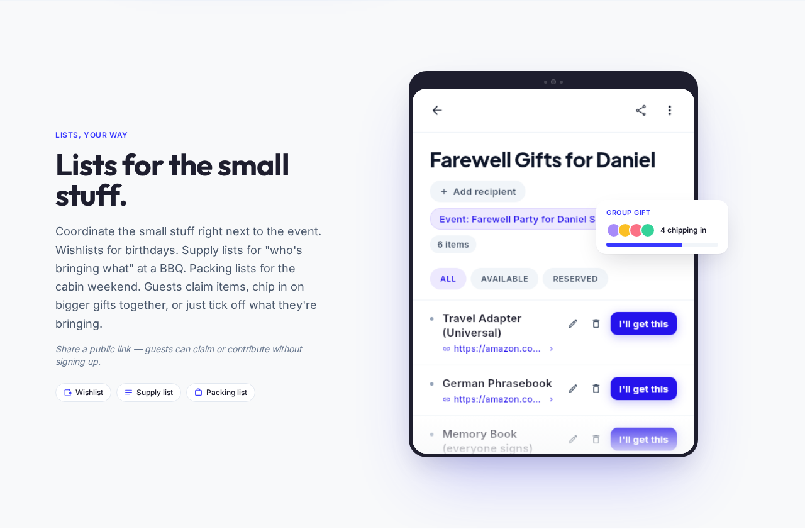
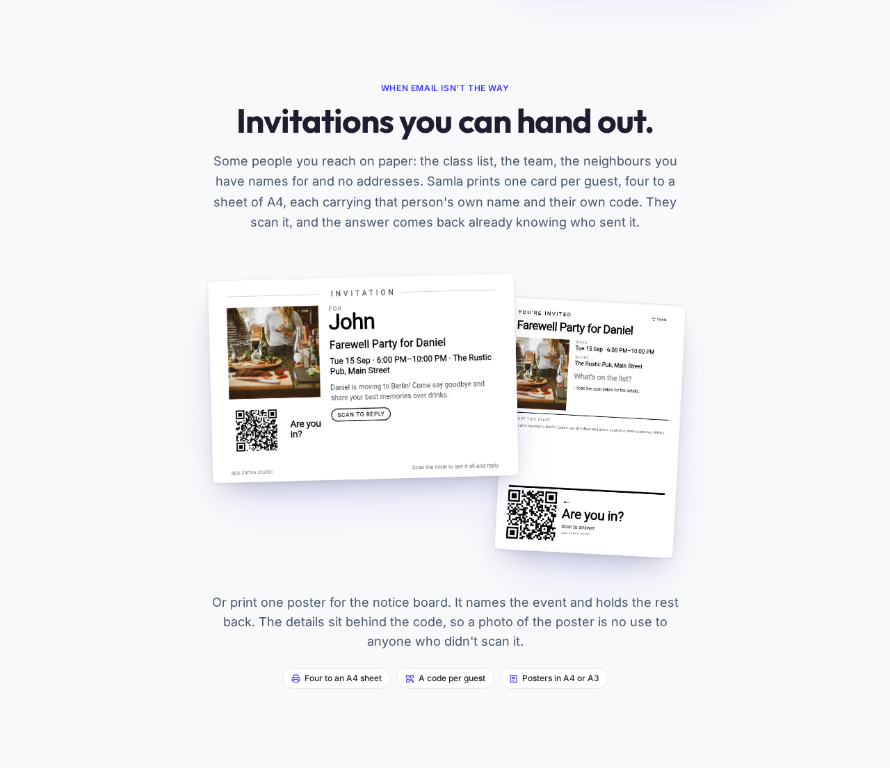

# Samla – case study

> *Gather your people. Plan anything.*

**Live: [app.samla.studio](https://app.samla.studio) and on Google Play** · The source code is private; I'm happy to walk through it on request.

## The problem

Every birthday, cabin trip or dugnad goes the same way. The invitation goes out in one group chat, the answers come back in three others, someone keeps a list in their notes app, and two people bring the same thing. The host spends the week before the event scrolling back to find out who said yes.

Samla puts the invitation, the answers and the list of what to bring in one place. Guests can answer from a link without creating an account.

## What it does

- **Events with RSVP** – guests answer *going*, *interested* or *can't make it*. They can bring companions up to a cap the host sets, with an optional approval step and a reply deadline.
- **Lists next to the event** – wishlists, supply lists, packing lists. Guests claim an item so nobody brings it twice, or several guests can share one item.
- **Surprise items** – guests can add something to a person's list that the person themselves never sees.
- **Printed invitations** – one card per guest, four to an A4 sheet, each with that person's name and their own QR code, so a paper reply comes back already knowing who sent it. Or one poster for the notice board.
- **My Crew** – the people you plan with, with birthdays and contact groups.
- **Notifications** – push notifications and transactional email for invitations, changes and reminders.

## Decisions that shaped it

**Guests never have to sign up.** Asking a grandparent to create an account to say "yes" loses the answer. Each guest gets a link with a random 256-bit token instead. The host and regular users sign in with Google or a one-time code by email: passwordless by default.

**One link, many answers, no spoilers.** Claims moved from "one person per item" to a pledge table, so several guests can share the same item. Surprise items are filtered out on the server, not just hidden in the UI, so the recipient can't find them by looking at the network traffic.

**Deleting an account really deletes it.** The in-app delete runs a full purge of everything the user owns (events, lists, pledges, invitations, settings) before removing the login itself. The database step is idempotent, so if the second step fails, running it again finishes the job.

**Paper is a feature.** Some groups are best reached on paper: a class list, a team, neighbours with no email addresses. Printed cards carry a per-guest code, so the reply is tied to the right person without anyone typing a name.

**Worded for groups, not just birthdays.** Birthdays are the main use, but the interface says *item*, *list* and *claim*, not *gift*, so the same screens work for a ski trip or a christening.

## How it's built

- **Flutter** for web (the main target), Android and Windows, with **Riverpod** for state and **go_router** for navigation
- **FastAPI** backend on **PostgreSQL (Supabase)**, with **Alembic** migrations
- Supabase auth with Google sign-in and email one-time codes; push notifications via Firebase Cloud Messaging; transactional email through Resend
- UUID keys and created/updated timestamps on every table; guest endpoints are scoped by a token, and account data requires a signed-in user
- About 400 backend tests (pytest) and 630 Flutter tests, and the test suite refuses to start if it points at a real database
- API on Railway, web on Firebase Hosting, Android as an App Bundle on Google Play

## How I work

I build with AI coding agents and treat their output like a colleague's pull request: tests, review, and nothing ships until it passes. Product decisions are written down in a decisions log. The standing one since August 2026 is *distribution before features*: work that reaches people who don't have Samla yet comes before polishing life for people who already do.

From the first commit in January 2026 to Google Play production in June, and about 1,400 commits and 250 versioned releases since, each with a changelog entry written for users.

## Status

Live on Google Play (production) since June 2026 and in the browser at [app.samla.studio](https://app.samla.studio). Free to use. Current focus: getting it to more groups.

---

**Jarek Urbanski** – education sector → software. [GitHub](https://github.com/jarurb007) · [LinkedIn](https://www.linkedin.com/in/jarek-urbanski/)
